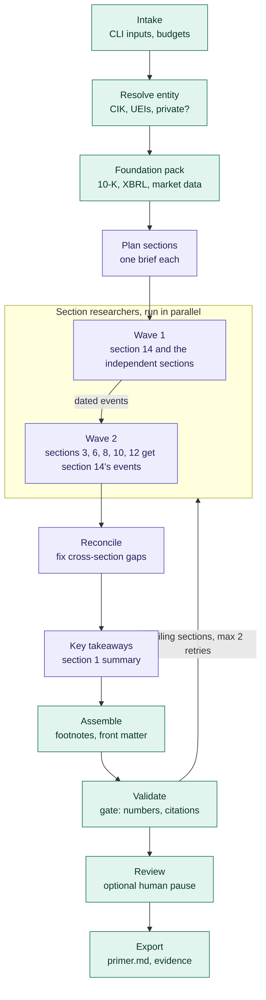
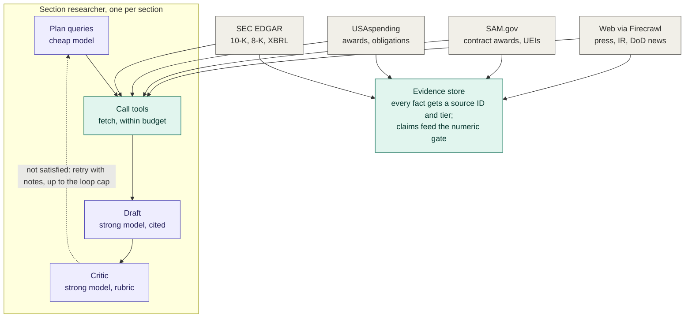

# Architecture

How the primer agent is put together and how its parts work together. The graphs are LangGraph
state graphs: `src/primer/graph/main.py` (the pipeline) and `src/primer/graph/researcher.py`
(one section researcher). The diagrams below render on GitHub. Purple boxes are steps where a
model writes or judges; teal boxes are plain code and rules.

## The pipeline

1. **Setup** runs once, in order. Intake reads the inputs and budgets, resolve entity finds the
   CIK and the SAM.gov/USAspending UEIs (or the private-company path), the foundation pack reads
   the 10-K, XBRL facts and market data, and one strong-model call plans a brief per section.
2. **Fan-out** runs the section researchers in parallel, in two waves. Wave 1 is section 14
   (Recent Developments) plus every section that does not read it. Wave 2 is sections 3, 6, 8, 10
   and 12, which are given section 14's dated events. When section 14 is not in the plan there is
   one wave.
3. **Reconcile** replaces "not in the evidence" sentences with cross-references to the section
   that has the fact, and raises a Conflict line where sections disagree. **Key takeaways** writes
   section 1 from the finished drafts.
4. **Assemble** builds the document (footnotes, front matter), and **validate** runs the gate:
   citations resolve, numbers match their claims, tiers and recency, exhibits, page budget. A
   failing section goes back to its researcher with the gate's notes, at most twice.
5. **Review** is a human pause that only happens in debug mode. **Export** writes `primer.md`,
   `claims.json`, `sources.json` and the evidence files into the run folder.

A SQLite checkpointer in the run folder lets a killed run resume at the failed node.

## One section researcher

Each section module follows the handler contract in [HANDLERS.md](HANDLERS.md): `plan`,
`collect`, `draft`. The researcher loop wraps it: plan the queries, collect from the sources
within the section's budget (`config/budgets.yaml`), draft with citations, and let the critic
send it back with notes until it passes or the loop cap is reached. Every fetched fact is
registered in the evidence store with a source ID and a tier (1 for filings and government
APIs), and the numbers in the draft are recorded as claims that the validation gate later checks
against it.

## Which model does what

Set in `config/models.yaml`; a role is a tier (`strong` or `cheap`) for the chosen provider.

| Role | Tier | Used by |
|---|---|---|
| `planner` | strong | plan sections |
| `query_planner` | cheap | plan queries, inside each researcher |
| `tool_loop` | cheap | the call-tools loop |
| `drafter` | strong | draft |
| `critic` | strong | critic |
| `synthesizer` | strong | key takeaways |
| `reconciler` | cheap | reconcile (one structured match call) |
| `judge` | strong | eval harness rubric |

Without a working model key the run falls back to template mode: the gate still passes but
nothing is model-drafted (the eval judge column then reads "(template)").
